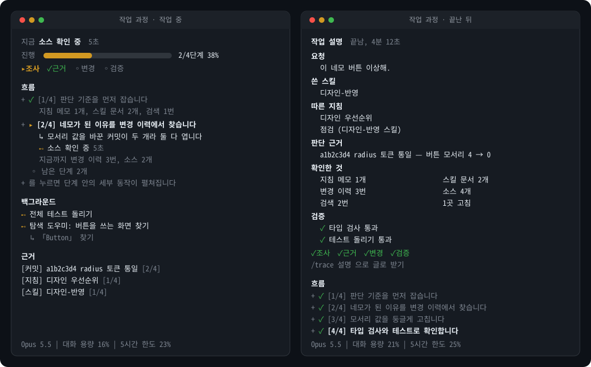
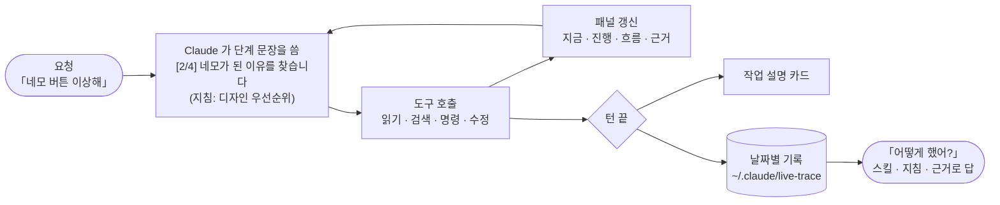
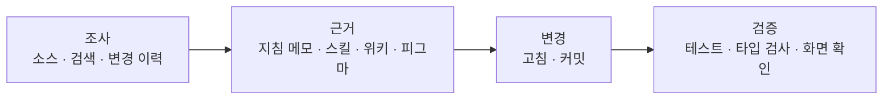

<div align="center">

# live-trace

**Claude Code 가 지금 무엇을 · 왜 · 무엇을 근거로 하는지, 옆 패널에 한국어로 보여 줍니다.**

끝난 작업은 「이 상황에서 이 스킬을 쓰고, 이 지침을 따라, 이렇게 했다」는 설명 카드로 남습니다.




</div>

<br>

## 목차

1. [왜 만들었나](#왜-만들었나)
2. [한눈에 보기](#한눈에-보기)
3. [설치](#설치)
4. [사용 방법](#사용-방법)
5. [화면 읽는 법](#화면-읽는-법)
6. [워크플로우](#워크플로우)
7. [동작 원리](#동작-원리)
8. [기록 파일과 「어떻게 했어?」](#기록-파일과-어떻게-했어)
9. [문제 해결](#문제-해결)
10. [개발](#개발)

<br>

## 왜 만들었나

터미널의 Claude Code 에는 **내가 보낸 요청 · 중간 질문 · 결과**만 남습니다.
「이 네모 버튼 이상해」라고 하면 「원으로 고쳤습니다」만 보이고, 그 사이는 보이지 않습니다.

- 왜 네모가 됐는지 (변경 이력)
- 어떤 스킬 · 지침 · 문서를 보고 판단했는지
- 고친 뒤 무엇으로 확인했는지

live-trace 는 이 **보이지 않는 과정**을 옆 패널에 실시간으로 흘려 보여 주고, 끝나면 설명 카드로 정리합니다.
그래서 「이거 어떻게 한 거예요?」라는 질문에 「Claude 가 해 줬어요」가 아니라 **근거를 들어** 답할 수 있습니다.

<br>

## 한눈에 보기

| | 기능 | 보이는 모습 |
|:-:|---|---|
| 🧭 | **지금 하는 일** | `지금 소스 확인 중  5초` · 경과 시간이 1초마다 흐름 |
| 📊 | **진행률** | `[2/4]` 단계 표시로 계산한 막대 + `▸조사 ✓근거 ◦변경 ◦검증` |
| 🪜 | **흐름** | 큰 단계가 위에서 아래로 쌓이고, 끝난 단계는 한 줄 요약으로 접힘 · `[ ▾ 펼치기 ]` 로 펼침 |
| 📚 | **근거** | 무엇을 봤나 + `왜:` 그 단계에서 Claude 가 쓴 이유 문장 · 지침과 스킬은 그 단계 바로 아래 |
| ⚑ | **훅 · 규칙** | 설정 훅이 막음 · 확인을 물음 · 고침 · 지시를 덧붙임, 그리고 불러온 규칙 문서(CLAUDE.md 등)와 그 이유 |
| 🗃 | **작업 목록** | 요청마다 작업 하나. `진행 중`(노랑 테두리) · `끝난 작업`(흐린 테두리) 상자로 나뉘고, `[ 2번 ]` 을 눌러 오감 |
| 🌙 | **백그라운드** | 뒤에서 도는 명령 · 도우미(서브에이전트) · 예약 작업마다 따로 — 어느 작업 것인지 · 동작 수 · 경과 시간 · 최근 동작 |
| 🧾 | **작업 설명 카드** | 요청 → 쓴 스킬 → 따른 지침 → 판단 근거 → 훅 · 규칙 → 확인한 것 → 검증 |
| 🗂 | **날짜별 기록** | `~/.claude/live-trace/YYYY-MM-DD.md` 에 쌓여, 며칠 뒤에도 「어떻게 했어?」에 답 |
| 📈 | **사용량** | 모델 · 대화 용량 · 5시간 / 주간 한도 |
| 💽 | **컴퓨터 여유** | `C 여유 3.7GB · 메모리 69%` 를 20초마다. 노랑 = 곧 멈춤(디스크 5GB · 메모리 80%), 빨강 = 셸 명령이 멈추는 선(resource-guard 와 같음: 디스크 2GB · 메모리 90% · 가용 2GB) |
| 🧹 | **디스크 정리** | 2GB 아래로 떨어지면 뒤에서 자동 정리 + 알림 · `[ 정리하기 ]` 로 직접도. 지우는 것은 사흘 넘은 임시 파일 · npm 내려받기 캐시 · 사흘 넘은 지난 Claude 세션 임시 폴더뿐 |

> [!NOTE]
> **화면 원칙.** 영어 도구 이름 · 명령 원문 · 상태 숫자는 보이지 않습니다.
> 파일 이름은 나열하지 않고 종류별 개수(`소스 5개`)로 셉니다.
> 글은 자르지 않고 줄을 바꿉니다. 색은 상태(초록 성공 · 노랑 진행 · 빨강 실패)에만 씁니다.

<br>

## 설치

> Claude Code **2.1.328** 에서 만들고 시험했습니다 (mods 기능이 있는 판).

### 방법 1 · 플러그인으로 설치 <sub>추천</sub>

Claude Code 입력창에서:

```text
/plugin install live-trace --marketplace dpfla8628/claude-live-trace
```

`Add marketplace?` 에 `y` → 범위는 맨 위 **User** 에서 Enter → `Installed live-trace` 가 뜨면 끝입니다. 바로 켜집니다.

셸에서 설치할 때:

```bash
claude plugin install live-trace --marketplace dpfla8628/claude-live-trace
```

데스크톱 앱에서는 입력창 옆 **+** → **Plugins** → **Add marketplace** 에 `dpfla8628/claude-live-trace` → **Add plugin**.

> [!IMPORTANT]
> 비공개 저장소입니다. 이 저장소를 읽을 수 있는 GitHub 계정이어야 하고,
> 설치하는 PC 에 github.com 자격 증명이 있어야 합니다 (SSH 키, 또는 `gh auth login` 뒤 `gh auth setup-git`).
> 설치 중에 로그인 창은 뜨지 않습니다.

### 방법 2 · 폴더째 늘 켜기 <sub>모든 프로젝트 · 모든 세션 · 고치면 바로 반영</sub>

```bash
git clone https://github.com/dpfla8628/claude-live-trace.git ~/.claude/mods/live-trace
```

`~/.claude/settings.json` 의 `env` 에 한 줄을 더합니다.

```jsonc
{
  "env": {
    "CLAUDE_CODE_PLUGIN_DIRS": "C:/Users/<나>/.claude/mods/live-trace"
  }
}
```

- 이 PC 에서 여는 모든 세션에 켜집니다. Orca 처럼 claude 를 대신 띄워 주는 도구로 연 세션도 같습니다.
- 폴더의 파일을 저장하면 열린 세션이 바로 다시 불러옵니다. 패널을 고쳐 가며 쓰기 좋습니다.

### 방법 3 · 한 번만 써 보기

```bash
claude --plugin-dir ~/.claude/mods/live-trace
```

### 패널을 오른쪽에 붙이기

패널은 **전체 화면 모드**에서만 대화 오른쪽에 붙습니다. 일반 모드에서는 입력창 위에 14줄로 뜹니다.

```jsonc
// ~/.claude/settings.json
{ "tui": "fullscreen" }
```

| 조건 | 내용 |
|---|---|
| 터미널 폭 | 110칸 이상이어야 오른쪽에 붙음 |
| 처음 폭 | 52칸 |
| 크기 조절 | 경계를 끌어서 넓히거나 줄임 (최대 화면의 45%) |

<br>

## 사용 방법

```text
① 평소처럼 요청          「이 네모 버튼 이상해」
② 옆에서 과정 보기        지금 하는 일 · 진행률 · 흐름 · 근거
③ 궁금한 단계 펼치기      단계 아래 [ ▾ 펼치기 ] 를 누름 → 그 단계의 동작이 하나씩
④ 끝나면 작업 설명 카드   위쪽이 카드로 바뀜
⑤ 나중에 물어보기         「이거 어떻게 했어?」 → 스킬 · 지침 · 근거로 답
```

패널은 세션이 시작될 때 알아서 열립니다. 닫았으면 `/trace` 로 다시 엽니다.

| 명령 | 하는 일 |
|---|---|
| `/trace` | 패널 열기 |
| `/trace 설명` | 마지막 작업 설명을 글(마크다운)로 받기 · 보고서나 메신저에 바로 붙여 넣기 |

> [!TIP]
> 요청에 「단계를 나눠서」를 붙이면 Claude 가 `[1/4]` 같은 단계 표시를 꼭 써서 진행률이 더 정확해집니다.

<br>

## 화면 읽는 법

### 기호

| 기호 | 뜻 | | 기호 | 뜻 |
|:-:|---|---|:-:|---|
| `▸` | 지금 하는 단계 | | `⊷` | 진행 중인 동작 · 백그라운드 |
| `✓` | 끝남 · 성공 | | `↳` | 큰 단계 안의 세부 단계 |
| `✗` | 실패 | | `◦` | 아직 안 함 |
| `⊘` | 막힘 (권한 거절) | | `[ ▾ 펼치기 ]` `[ ▴ 접기 ]` | 단계 펼치기 · 접기 |
| `⚑` | 훅이 한 일 · 불러온 규칙 (빨강 막음 · 노랑 물음 · 고침) | | | |

### 작업 중

| 줄 | 뜻 |
|---|---|
| **지금** | 지금 하는 동작과 그 동작이 걸린 시간 |
| **진행** | `[n/m]` 단계 표시가 있으면 `n/m단계 %`, 없으면 조사 → 근거 → 변경 → 검증 중 어디까지 왔는지로 어림 |
| **단계 줄** | `조사` 소스 · 검색 · 이력 / `근거` 지침 · 스킬 · 위키 / `변경` 고침 · 커밋 / `검증` 테스트 · 타입 검사 · 화면 확인 |
| **흐름** | Claude 가 도구 앞에 쓴 문장이 단계 제목. `[n/m]` 이 붙은 문장이 큰 단계, 표시 없는 문장은 그 아래 세부 단계(`↳`) |
| **단계 아래** | `지침 디자인 우선순위` · `스킬 디자인-반영` — 그 단계에서 따른 것 / `⚑ 훅이 막음: …` — 그 단계의 도구를 훅이 막거나 고친 일 |
| **백그라운드** | 뒤에서 도는 셸 · 감시 · 예약 · 도우미와 도우미의 최근 동작 |
| **판단 근거** | 찾은 커밋 · 외부 근거. 아래 흐린 `왜:` 는 그것을 찾은 단계에서 Claude 가 쓴 「무엇을 · 왜」 문장 |

```text
판단 근거
  변경 기록 「radius 토큰 통일」
    왜: 네모가 된 이유부터 찾으려고 버튼 변경 이력을 봅니다
```

### 여러 작업 · 병렬 작업

요청 하나가 **작업 하나**입니다. 한 세션에서 요청을 두 번 이상 보내면 패널 맨 위에 작업 목록이 생깁니다.

```text
╭──────────────────────────────────────╮   ← 노랑 테두리
│ 진행 중 2개                           │
│ [ 3번 ] ▸ 버튼 높이도 맞춰줘  17%  보는 중 │   ← 지금 보는 작업 (굵게)
│ [ 1번 ] ⊷ 이 네모 버튼 이상해  뒤에서 계속 │   ← 끝났지만 도우미가 아직 도는 작업
╰──────────────────────────────────────╯
╭──────────────────────────────────────╮   ← 흐린 테두리
│ 끝난 작업 1개                         │
│ [ 2번 ] ✓ 카드 모서리 값  끝남, 2분 45초  │
╰──────────────────────────────────────╯
```

| 상황 | 패널이 하는 일 |
|---|---|
| 작업이 끝난 뒤 새 요청을 보냄 | 새 작업을 만들고 그 작업을 보여 줌. 지난 작업은 목록에 남음 (진행률이 0% 로 덮이지 않음) |
| 작업 **도중에** 요청을 더 침 | Claude Code 가 그 글을 지금 작업에 넣어 주므로 새 작업이 아니라 **추가 요청** — `지금` 줄 아래 `추가 요청 …` 이 뜨고, 끝난 카드의 요청 칸에 `작업 중 추가: …` 로 남음 |
| 작업 도중에 `ctrl+x enter` 로 기다리게 보냄 | 지금 작업이 끝난 뒤 제 차례에 시작하므로 새 작업 |
| 지난 작업을 보고 싶음 | 목록의 `[ 1번 ]` 을 누르면 그 작업의 작업 설명 카드와 흐름. 가장 최근 번호를 누르면 다시 지금 작업을 따라감 |
| 백그라운드 작업이 끝나 Claude 가 이어서 일함 | 새 작업이 아니라 **같은 작업에 이어 붙음** — 진행률 · 흐름 · 걸린 시간이 이어짐 |
| `/loop` 같은 반복 예약이 같은 글로 다시 돎 | 같은 작업에 이어 붙음 |
| 도우미 여러 명이 동시에 일함 | 백그라운드 칸에 도우미마다 한 줄: 무엇을 맡았는지 · 몇 번 작업 것인지 · 동작 수 · 경과 시간 · 최근 동작(`↳`) |
| Orca 등으로 세션을 여러 개 띄움 | 세션마다 패널이 따로 뜨고, 제목에 작업 폴더 이름이 붙음 — `작업 과정 (my-app)` |

### 동작 이름 — 파일 이름 대신 종류로

| 읽은 것 | 패널에 보이는 말 |
|---|---|
| 일반 코드 | `소스 확인` |
| `memory/*.md` | `지침 메모 확인` · 지침 이름은 `MEMORY.md` 의 한글 제목 |
| `CLAUDE.md` · `AGENTS.md` | `프로젝트 규칙 확인` |
| `skills/**` | `스킬 문서 확인` |
| `*.ai.md` · `specs/` · `decisions/` | `AI 문서 확인` |
| 플러그인 · `.claude/rules` 문서 | `플러그인 문서 확인` |
| 위키(Confluence) · 지라 · 피그마 | `위키에서 확인` · `지라에 쓰기` · `피그마 화면 캡처` |
| `git log` · `blame` / `show` / `diff` | `변경 이력 보기` / `커밋 내용 보기` / `바뀐 내용 비교` · 개수는 모두 「변경 이력」 |
| 셸 명령 | Claude 가 쓴 한국어 설명 그대로 (`타입 검사`, `테스트 돌리기` …) |

한글 파일 이름은 붙여서 보여 줍니다 → `AI 문서 「점검」 확인`.
영어 파일 이름은 `[ ▾ 펼치기 ]` 로 펼쳤을 때만 흐리게 보입니다.

### 끝난 뒤 — 작업 설명 카드

| 칸 | 어디서 오나 |
|---|---|
| **요청** | 보낸 요청의 첫 문장 |
| **쓴 스킬** | 불러온 스킬 · 읽은 스킬 문서 |
| **따른 지침** | Claude 가 문장 끝에 적은 `(지침: 이름)` · 읽은 지침 메모의 한글 제목 · 스킬 안 AI 문서 |
| **판단 근거** | 최종 답에 나온 커밋 (없으면 마지막에 찾은 3개) · 피그마 노드 · 지라 키 · 위키 페이지 |
| ↳ `왜:` | 위 세 칸의 항목마다, 그것을 찾은 단계에서 Claude 가 쓴 「무엇을 · 왜」 문장 |
| **훅 · 규칙** | 막음 → 물음 → 고침 → 덧붙인 지시 → 불러온 규칙 문서 순, 6개까지. `(2번)` 은 같은 일이 두 번 |
| **확인한 것** | 종류별 개수, 두 칸 격자 |
| **검증** | 검사 · 테스트 결과. 바꾼 뒤 검증이 없으면 `✗ 바꾼 뒤 검증하지 않았습니다` (문서만 고친 건 빼고) |

<br>

## 워크플로우



한 작업은 보통 네 단계를 지납니다. 패널의 단계 줄이 이 흐름을 따라 켜집니다.



<br>

## 동작 원리

Claude Code **mod** (플러그인 + hooks 모듈) 하나입니다. 따로 도는 프로그램이나 네트워크 없이, 엔진이 알려 주는 이벤트만 봅니다.

| 엔진 이벤트 | live-trace 가 하는 일 |
|---|---|
| `session.start` | `/trace` 명령 등록 · 패널 열기 · 작업 중엔 1초마다 다시 그림 |
| `prompt.compose` | 시스템 프롬프트에 「문장 규칙」 한 절을 더함 (아래) |
| `prompt.submit` | 작업 중에 사용자가 친 글(엔진이 지금 턴에 넣어 준 것)을 지금 작업의 추가 요청으로 |
| `turn.start` | 사용자 요청이면 새 작업을 만들고, 이어서 하는 턴(빈 글 · `<task-notification>` · 같은 글 반복)이면 지금 작업에 붙임 |
| `turn.step` | Claude 가 화면에 쓰는 문장을 모아, 도구 바로 앞 문장을 단계 제목으로. `[n/m]` · `(지침: …)` 을 읽음. 생각(thinking)은 읽지 않음 |
| `tool.call` | 도구 호출 → 한국어 동작 · 단계(조사/근거/변경/검증) · 종류. 결과에서 커밋 · 지침 · 외부 근거를 뽑음 |
| `skill.prompt` | 불러온 스킬을 근거로 |
| `agent.spawn` | 도우미(서브에이전트)를 백그라운드에 올림 |
| `classic.Stop` | 엔진이 아는 백그라운드 작업 · 예약 목록으로 맞춤 · 끝내려 할 때 훅이 막았으면 적음 |
| `classic.PreToolUse` · `classic.PostToolUse` | 설정 훅의 결정(막음 · 확인을 물음 · 입력이나 결과를 바꿈 · 덧붙인 지시)을 그 도구가 속한 단계에 적음. 막은 이유는 훅이 내보낸 글에서 |
| `classic.UserPromptSubmit` · `classic.SessionStart` | 요청 · 세션 시작 때 훅이 덧붙인 지시나 막은 일을 그 작업에 적음 |
| `classic.InstructionsLoaded` | CLAUDE.md · `.claude/rules` 같은 규칙 문서가 대화에 올라올 때 무엇을 · 왜(세션 시작 · 하위 폴더 진입 · 경로 규칙 일치 …) 불러왔는지 적음 |
| `turn.complete` | 작업 설명을 만들고 날짜별 기록에 씀 (같은 작업은 한 절을 새로 씀) |
| `ui.render` | 패널을 그림 (터미널 · 데스크톱 · VS Code · 모바일) |

> 관찰용 훅은 모두 실패해도 원래 동작을 막지 않게 감싸 두었습니다. 패널이 고장 나도 Claude 의 작업은 그대로 진행됩니다.
>
> **세션마다 떠도 가볍게.**
> - 디스크 · 메모리는 `node` 를 한 번 띄워 잽니다(0.1초 안팎). 잰 값은 `~/.claude/live-trace/host.json` 에 두고 모든 세션이 같이 읽어, 세션이 몇 개든 컴퓨터 전체에서 20초에 한 번만 잽니다.
> - 자동 정리도 같은 파일에 시작 시각을 적어 모든 세션을 통틀어 30분에 한 번까지만 돕니다. 정리 중에는 그 세션의 `[ 정리하기 ]` 가 숨습니다.
> - 화면은 작업 중일 때만 1초마다 다시 그립니다(경과 시간). 쉬는 동안은 그리지 않습니다.
> - 상태는 작업 10개 · 동작 300개 · 근거 150개 · 훅 기록 100개까지만 들고, 목록에서 빠진 작업의 동작 · 근거 · 훅 기록은 함께 지웁니다.
> - 메모리가 모자랄 때 「잠깐 멈추기」는 resource-guard 가 이미 합니다(최대 45초 기다린 뒤 보류). 패널은 그때 맨 위에 빨간 안내와 `⚑ 훅이 막음` 줄로 보여 줍니다.
>
> 설정 훅은 이 mod **아래에서** 돕니다(관리자 훅 → mod → 설정 훅). 그래서 mod 가 받는 결과가 곧 설정 훅들이 합친 결정이고, mod 는 그 값을 바꾸지 않고 그대로 넘깁니다.
> 별도 프로세스를 띄우는 명령형 훅이 아니라 같은 프로세스 안의 관찰이라, 관찰용 훅이 늘어 느려지는 문제는 생기지 않습니다.

### Claude 가 지키는 문장 규칙

`prompt.compose` 로 시스템 프롬프트에 들어갑니다. 패널이 읽기 좋은 문장을 Claude 가 쓰게 합니다.

- 화면에 쓰는 **모든 문장은 한국어** — 출력 스타일 · 시스템 안내가 영어여도. 그래도 영어로 쓴 도구 앞 문장은 패널이 알아채 그 도구 결과에 「다음 문장부터 반드시 한국어로」 안내를 붙여 바로잡습니다 (`README.md 를 봅니다` 처럼 파일 이름만 영어인 문장은 해당 없음)
- 도구를 부르기 전 **「무엇을 · 왜」 한 줄 한국어** — `네모가 된 이유부터 찾으려고 버튼 변경 이력을 봅니다`
- 여러 단계 작업이면 **`[지금/전체]`** — `[2/4] 피그마 원본과 비교합니다`
- 지침을 따를 때 **`(지침: 이름)`** — `(지침: 디자인 우선순위)`
- 셸 명령의 설명은 한국어
- 「어떻게 했어?」에는 기록 파일을 읽고 **상황 → 쓴 스킬 → 따른 지침 → 근거 → 한 일 → 검증** 순서로 답

<br>

## 기록 파일과 「어떻게 했어?」

작업이 끝날 때마다 `~/.claude/live-trace/YYYY-MM-DD.md` 에 한 절씩 쌓입니다. 머리에 작업 폴더 이름이 붙고, 이어서 한 턴이 끝나면 같은 절을 새로 씁니다. `/trace 설명` 이 돌려주는 글도 같습니다.

```markdown
### 14:09 [my-app] 이 네모 버튼 이상해. 원래 둥글어야 하는 거 아니야?
- 상황: 이 네모 버튼 이상해. 원래 둥글어야 하는 거 아니야?
- 쓴 스킬: 디자인-반영
- 따른 지침: 디자인 우선순위, 점검 (디자인-반영 스킬)
- 근거: a1b2c3d4 radius 토큰 통일 — 버튼 모서리 4 → 0
- 확인한 것: 지침 메모 1개, 스킬 문서 2개, 변경 이력 3번, 소스 4개, 검색 2번, 1곳 고침 (걸린 시간 4분 12초)
- 한 일:
  1. [1/4] 판단 기준을 먼저 잡습니다
  2. [2/4] 네모가 된 이유를 변경 이력에서 찾습니다
  3. [3/4] 모서리 값을 둥글게 고칩니다
  4. [4/4] 타입 검사와 테스트로 확인합니다
- 검증: 타입 검사 통과, 테스트 돌리기 통과
```

며칠 뒤 「지난주 버튼 그거 어떻게 했어?」라고 물으면, Claude 가 이 파일을 읽고 위 순서대로 답합니다.

<br>

## 문제 해결

| 증상 | 해결 |
|---|---|
| 패널이 입력창 위에 뜸 | `"tui": "fullscreen"` 을 켜고, 터미널 폭을 110칸 이상으로 |
| 패널이 안 보임 | `/trace` 로 열기 · `/plugin` 에서 켜져 있는지 확인 |
| 단계가 `(1)` `(2)` 로만 나옴 | Claude 가 `[n/m]` 표시 없이 일한 작업입니다. 요청에 「단계를 나눠서」를 붙여 보세요 |
| 지침 이름이 안 나오고 개수만 나옴 | 메모 폴더의 `MEMORY.md` 에 `- [한글 제목](파일.md)` 줄이 있어야 이름을 찾습니다 |
| `바꾼 뒤 검증하지 않았습니다` 가 뜸 | 코드를 고친 뒤 테스트 · 타입 검사 · 빌드 · 화면 확인이 한 번도 없었다는 뜻입니다 |
| 끄고 싶음 | 방법 1: `/plugin` 에서 끄기 · 방법 2: settings 의 `CLAUDE_CODE_PLUGIN_DIRS` 줄 삭제 |

<br>

## 개발

```bash
claude plugin validate .   # 모듈 · 매니페스트 검사
claude plugin test .       # 시험 19개
```

| 파일 | 하는 일 |
|---|---|
| `.claude-plugin/plugin.json` | 이름 · 버전 · 설명 |
| `.claude-plugin/marketplace.json` | `/plugin install` 용 목록 |
| `hooks/hooks.json` | 모듈 위치 |
| `hooks/register.tsx` | 이벤트 훅 · 상태 · 패널 그리기 |
| `hooks/describe.ts` | 도구 → 한국어 이름 · 단계 · 종류 · 근거 (엔진을 부르지 않는 순수 함수) |
| `hooks/register.test.tsx` | 시험 — 작업 나누기 · 이어서 하는 턴 · 작업 중 추가 요청 · 한국어 이름 · 종류 분류 · 커밋 추출 · 문장 해석 · 흐름 · 펼침 · 작업 설명 카드 · 백그라운드 · 빈 화면 |
| `types/index.d.ts` | 상태 타입 계약 |
| `assets/panel.svg` | README 그림 |

방법 2 로 설치했다면 파일을 저장하는 즉시 열린 세션에 다시 불러옵니다.
상태 모양을 바꾸면 `register.tsx` 의 `shape` 태그를 올려 예전 값을 버리게 합니다.
